# Manual de usuario — FitZone Sports

**Versión:** 1.0 · **Fecha:** 2026-11-09 · **Sistema:** FitZone Sports v1.0 (portal del socio y consola de administración)

Las capturas son del sistema entregado, levantado con los datos de prueba (25 sedes). Los nombres de personas son ficticios.

---

## 1. Qué es FitZone Sports y para qué sirve

FitZone Sports es la plataforma de una cadena de gimnasios con más de 25 sedes. Desde un mismo sitio web:

- **El socio** paga su membresía, muestra su código QR para entrar a cualquier sede, reserva clases grupales (spinning, yoga, funcional, pilates) y alquila canchas de paddle y fútbol 5 con descuento.
- **El cliente externo**, sin membresía, alquila canchas pagando por uso.
- **El recepcionista** valida los ingresos en el mostrador, controla cuánta gente hay dentro, cobra en efectivo y anota socios a clases y canchas.
- **El gerente de sede** administra su sede: canchas, clases, instructores, personal y reportes.
- **El gerente general** administra la cadena entera: sedes, precios, gerentes y reportes consolidados.

El sistema funciona en cualquier navegador moderno, en computadora o teléfono. En el teléfono se puede **instalar como aplicación** (ver 3.3).

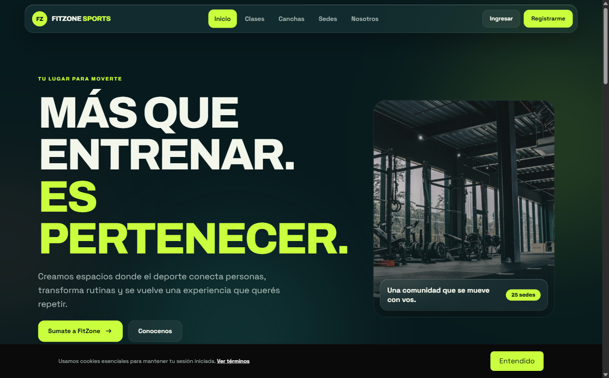
*Figura 1. Página de inicio pública: sedes, actividades y acceso al portal.*

## 2. Cómo leer este manual · Glosario

El manual está organizado por rol. Cada usuario ve solo las pantallas de su rol: si una opción de este manual no aparece en su menú, es porque corresponde a otro rol.

| Término | Significado |
|---|---|
| **Socio** | Persona con membresía. Puede estar *al día* (membresía vigente) o *en mora* (membresía vencida). |
| **Cliente externo** | Persona registrada sin membresía. Solo alquila canchas. |
| **Membresía vigente** | Plan pagado cuyo período incluye el día de hoy. |
| **Membresía próxima** | Plan ya pagado que empieza cuando termina el vigente (renovación anticipada). |
| **QR rotativo** | Código de ingreso personal que cambia cada 60 segundos. Una captura de pantalla no sirve para entrar. |
| **Código de 6 dígitos** | Alternativa al QR, se genera junto con él y vence al mismo tiempo. |
| **Aforo** | Cantidad máxima de personas que puede haber dentro de una sede. |
| **Ocurrencia** | Una fecha y horario concretos de una clase (por ejemplo, *Yoga del martes 17/11 a las 09:00*). |
| **Lista de espera** | Fila para una clase llena. Si se libera un lugar, el primero de la lista pasa a tener la reserva y se le avisa. |
| **Hora pico** | Turnos de cancha que empiezan entre las 19:00 y las 20:59. Tienen recargo. |
| **Comprobante** | PDF que se genera con cada pago aprobado. |

### Ingreso al sistema

Hay dos puertas de ingreso:

- **Socios y clientes externos:** botón *Ingresar* de la página pública (`/login`).
- **Personal (recepción y gerencia):** `/admin/login`.

Se ingresa con email y contraseña. Si la cuenta todavía no confirmó su email, el sistema lo pide antes de dejar entrar.

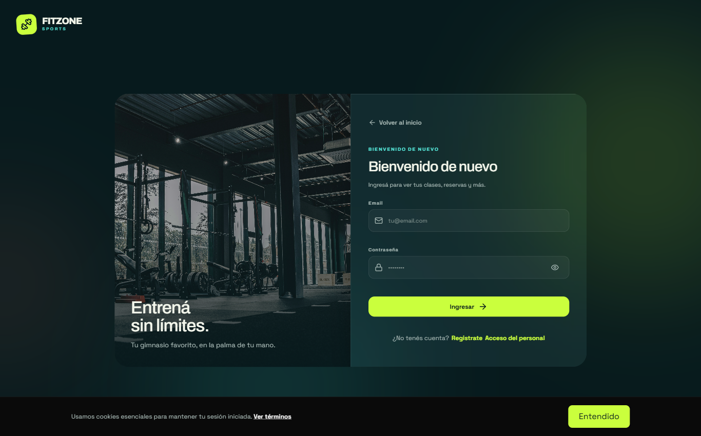
*Figura 2. Ingreso de socios y clientes.*

---

## 3. Manual del Socio

### 3.1 Registro y carga del perfil

1. En la página pública, elegí **Registrarme**.
2. Completá nombre, apellido, DNI, email, teléfono y contraseña (mínimo 8 caracteres). La foto es opcional.
3. Aceptá los términos y condiciones y confirmá.
4. Vas a recibir un **mail de verificación**. Abrí el link (vale 24 horas) para activar la cuenta.
5. Ingresá con tu email y contraseña.

El DNI y el email no se pueden repetir: si ya existe una cuenta con alguno de los dos, el sistema lo avisa.

Para cambiar tus datos o tu contraseña, entrá a **Mi cuenta**.

### 3.2 Contratación y renovación de la membresía

Al ingresar por primera vez el sistema te lleva a **Completar membresía**:

1. Elegí el plan: **Mensual**, **Trimestral** o **Anual**. El precio lo fija la gerencia y se muestra en pantalla.
2. Elegí tu sede de alta. Igual vas a poder entrar a **todas** las sedes de la cadena.
3. Elegí el medio de pago (Mercado Pago o MODO) y confirmá.

Si el pago se aprueba, la membresía queda **activa desde hoy**. Si se rechaza, podés volver a intentar.

**Renovación anticipada.** Desde **Mi membresía** podés pagar el próximo período antes de que venza el actual. El nuevo plan queda como **próximo** y empieza el día en que termina el vigente, sin perder días. Se permite una membresía vigente y una próxima a la vez.

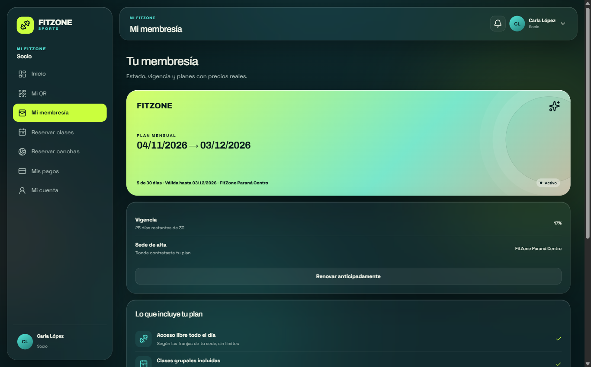
*Figura 3. Mi membresía: plan vigente, fecha de fin y renovación.*

**Estados de la membresía:**

| Estado | Qué significa | Qué podés hacer |
|---|---|---|
| Activa (vigente) | El período incluye hoy | Todo: ingresar, reservar clases, canchas con descuento |
| Vencida | Terminó el período | Renovar. Mientras tanto no entrás al gimnasio ni reservás clases; las canchas se pagan a tarifa de externo |
| Suspendida | La gerencia la suspendió o un pago falló | Contactar a la sede |

### 3.3 Obtención del código QR e ingreso al gimnasio

1. Entrá a **Mi QR** (también está el atajo *Tu pase de hoy* en el inicio).
2. Mostrale el QR al recepcionista. Él lo lee con la cámara.
3. Si la cámara no lo lee, dictale el **código de 6 dígitos** que aparece debajo.

El QR y el código **cambian cada 60 segundos** y cada uno sirve **una sola vez**. Por eso una foto o captura del QR no sirve.

Con tu membresía podés entrar a **cualquier sede** de la cadena. No podés estar registrado dentro de dos sedes a la vez: si te olvidaste de marcar la salida en una, pedile al recepcionista que registre el egreso.

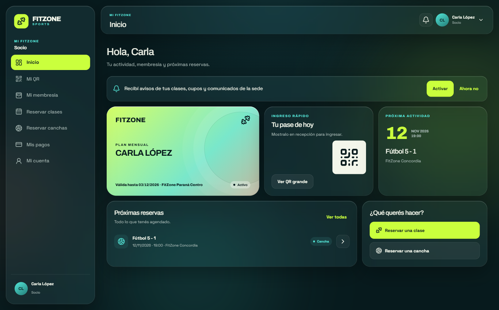
*Figura 4. Inicio del socio: tarjeta de membresía, pase rápido y próximas reservas.*

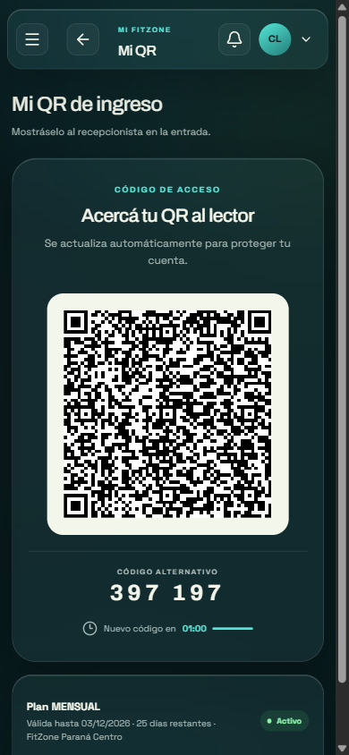
*Figura 5. Mi QR en un teléfono: QR rotativo y código de 6 dígitos.*

**Instalar la aplicación en el teléfono.** El portal es una aplicación web instalable:

- **Android (Chrome):** menú ⋮ → *Instalar aplicación* (o el botón *Instalar* que aparece en el portal).
- **iPhone (Safari):** botón Compartir → *Agregar a pantalla de inicio*.

Instalada, se abre a pantalla completa y puede recibir notificaciones.

### 3.4 Qué hacer si el QR no es aceptado o la sede está sin conexión

| Mensaje en recepción | Causa | Qué hacer |
|---|---|---|
| *QR inválido o expirado* | Pasó más de un minuto desde que se generó | Esperá a que se renueve el QR y mostralo de nuevo |
| *Este QR ya fue usado* | El mismo QR se intentó usar dos veces | Mostrá el QR actualizado |
| *Necesitás una membresía activa* | La membresía venció o está suspendida | Renová desde *Mi membresía* o en el mostrador |
| *Ya tiene un ingreso abierto en otra sede* | Figura dentro de otra sede | Pedí que registren tu egreso en la sede anterior |
| *La sede alcanzó su aforo máximo* | La sede está llena | Esperá a que salga alguien |

**Si no podés mostrar el QR** (sin batería o sin datos), el recepcionista puede registrar tu ingreso con tu **DNI**, después de verificar tu documento.

**Si la sede no tiene conexión a internet**, el ingreso con QR sigue funcionando. El recepcionista ve el aviso *Modo sin conexión* y la pantalla valida tu QR con los datos que descargó antes de la caída (membresías vigentes de la red y quiénes están dentro). Vos hacés lo mismo que siempre: mostrás el QR de tu teléfono y el recepcionista lo lee con la cámara.

- El resultado aparece con la insignia **Sin conexión**: el ingreso quedó guardado en el equipo de recepción y se envía al sistema cuando vuelve internet. No tenés que hacer nada más.
- Sin conexión **no funcionan** el ingreso por código de 6 dígitos ni por DNI, y tampoco se pueden registrar egresos hasta que vuelva la red. Por eso conviene mostrar el QR.
- Si ya habías ingresado a otra sede y no marcaste la salida, al volver la conexión el sistema puede informar un conflicto y el recepcionista tendrá que resolverlo con vos (ver 4.4).
- Si el equipo de recepción no tiene datos descargados vigentes, el aviso lo indica y el ingreso se registra a mano hasta que vuelva internet.

**Si es tu teléfono el que no tiene conexión**, el portal no puede mostrar ni renovar tu QR (el código se genera con conexión y cambia cada 60 segundos). En ese caso pedile al recepcionista que registre tu ingreso con tu **DNI**, que requiere que la sede tenga internet.

### 3.5 Reserva de clases grupales y lista de espera

1. Entrá a **Reservar clases**.
2. Filtrá por **sede**, **actividad** y **día**. Cada clase muestra horario, sede, instructor y lugares libres.
3. Tocá **Reservar**.

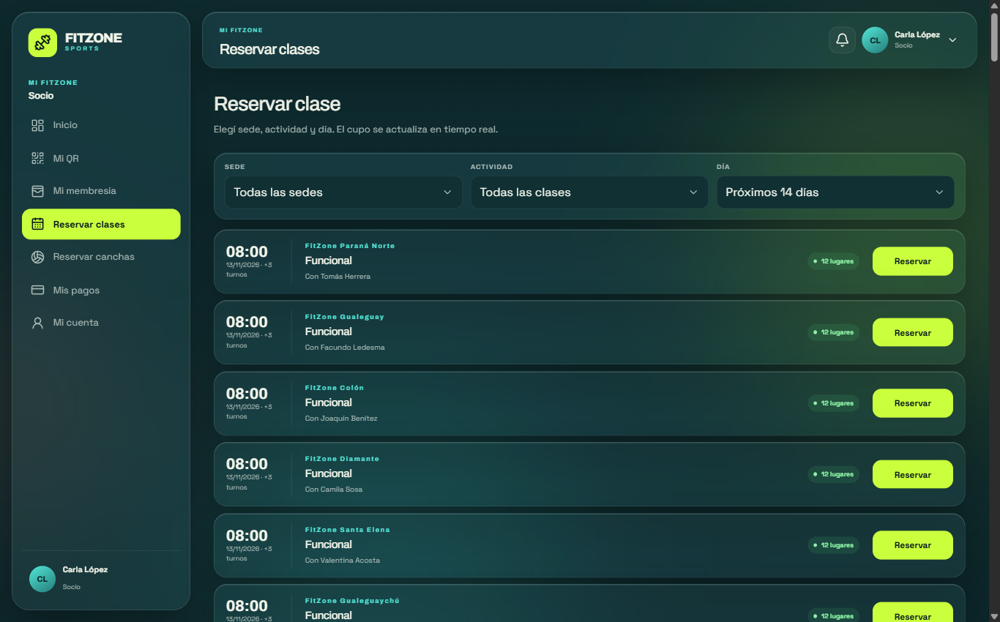
*Figura 6. Reservar clases: filtros por sede, actividad y día, con lugares disponibles.*

Reglas:

- Necesitás la **membresía vigente**.
- Podés reservar con al menos **48 horas de anticipación** al inicio de la clase.
- Si la clase está llena, quedás en **lista de espera**. Cuando alguien cancela, el primero de la lista pasa automáticamente a tener la reserva y recibe una notificación (en la campanita, por mail y, si las activaste, en el teléfono).

Tus reservas aparecen en **Mis reservas**, debajo de la lista de clases, y en el inicio.

### 3.6 Reserva de canchas y cómo se calcula el precio

1. Entrá a **Reservar canchas**.
2. Elegí sede, tipo de cancha (paddle o fútbol 5) y fecha.
3. Elegí un turno libre de la grilla. Los turnos son de **una hora en punto**, con inicio entre las **08:00 y las 22:00**.
4. Revisá el precio y pagá con Mercado Pago o MODO.

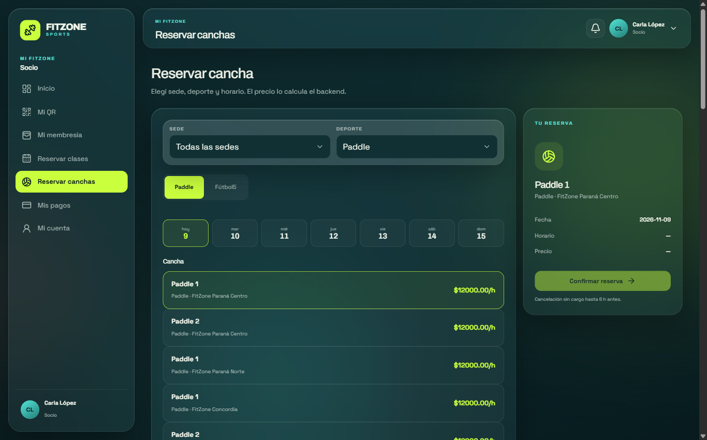
*Figura 7. Reservar canchas: grilla de turnos libres por cancha.*

**Cómo se calcula el precio.** Cada cancha tiene un precio por hora. Sobre ese precio:

| Situación | Ajuste |
|---|---|
| Socio con la cuota al día | **15 % de descuento** |
| Turno en hora pico (empieza entre 19:00 y 20:59) | **15 % de recargo** |
| Socio al día en hora pico | Se aplican los dos |
| Socio con la cuota vencida o cliente externo | Precio base, sin descuento (tarifa de externo) |

Ejemplo con una cancha de $12.000 la hora: un socio al día paga $10.200 a las 10:00 y $11.730 a las 19:00; un externo paga $12.000 a las 10:00 y $13.800 a las 19:00.

El precio lo calcula siempre el sistema; lo que se muestra antes de pagar es lo que se cobra.

**Dos personas al mismo tiempo:** si dos usuarios intentan reservar el mismo turno en el mismo instante, el sistema confirma solo a uno. Al otro le avisa *Ese horario ya fue reservado* y puede elegir otro turno.

### 3.7 Cancelaciones, plazos y penalidades

| Reserva | Plazo para cancelar | Penalidad |
|---|---|---|
| Clase | Hasta **2 horas antes** del inicio | Ninguna dentro del plazo. Después ya no se puede cancelar desde el portal |
| Cancha | Sin plazo | Ninguna |

Para cancelar, abrí la reserva en **Mis reservas** y tocá **Cancelar**. Al cancelar una clase, tu lugar pasa al primero de la lista de espera.

### 3.8 Comprobantes de pago

Cada pago aprobado genera un **comprobante en PDF** con el concepto (membresía o cancha), sede, fecha y horario, monto y medio de pago.

1. Entrá a **Mis pagos**.
2. Tocá **Comprobante** en el pago que quieras y descargá el PDF.

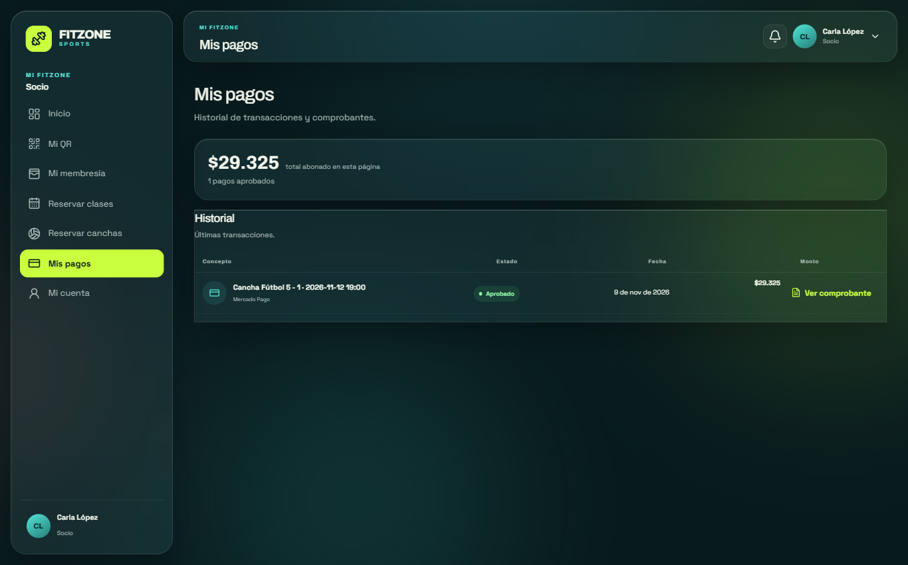
*Figura 8. Mis pagos: historial de pagos con su comprobante.*

---

## 4. Manual del Recepcionista / Administrador de sede

El recepcionista ingresa por `/admin/login` y ve solo su sede.

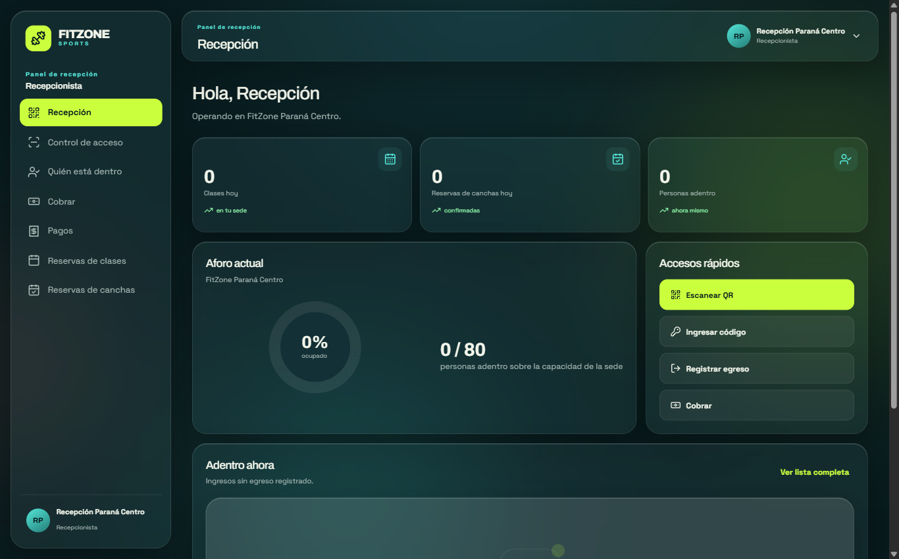
*Figura 9. Panel de recepción: accesos rápidos, aforo y actividad del día.*

### 4.1 Validación de ingreso y lectura del aforo

Entrá a **Control de acceso**. Hay cuatro formas de validar:

| Modo | Cuándo usarlo |
|---|---|
| **Cámara** | Forma normal: apuntá la cámara de la computadora o tablet al QR del socio |
| **Código** | El socio te dicta los 6 dígitos que ve debajo de su QR. Al completar el sexto dígito se valida solo |
| **Pegado** | Si un lector externo entrega el texto del QR |
| **DNI** | El socio no puede mostrar el QR. **Verificá su documento** antes de validar; el sistema muestra nombre, foto y estado de la membresía para confirmar |

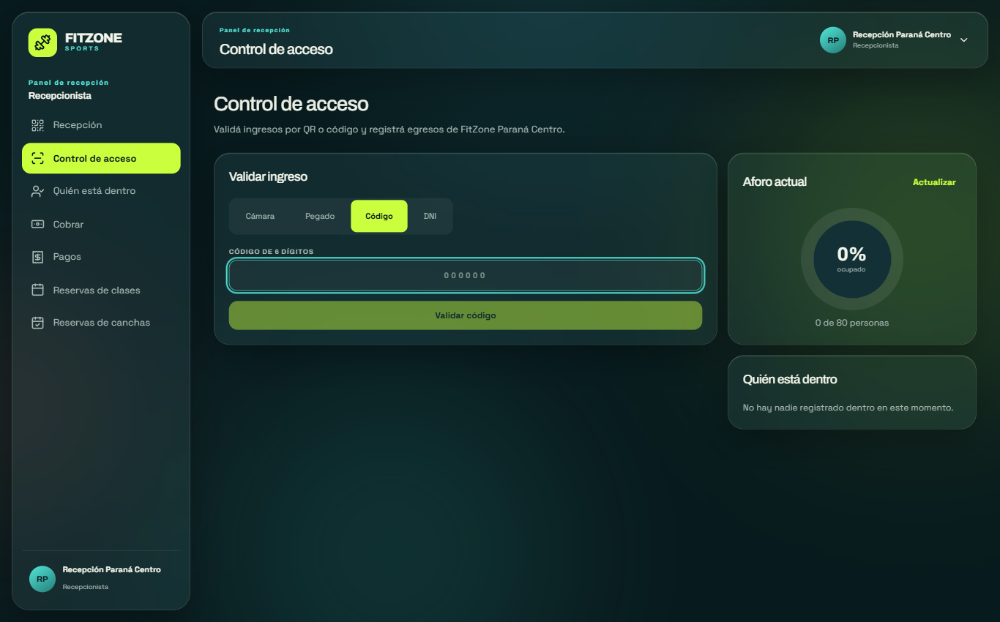
*Figura 10. Control de acceso: modos de validación, aforo actual y lista de quién está dentro.*

El sistema rechaza el ingreso, con el motivo, si la membresía no está vigente, si el socio ya figura dentro de otra sede o si la sede llegó al aforo máximo.

**Sin conexión.** Si se cae internet, aparece el aviso *Modo sin conexión* y el botón **Sincronizar ahora**. Mientras haya datos descargados vigentes, solo los modos **Cámara** y **Pegado** siguen funcionando: validan el QR con la copia local y el resultado lleva la insignia **Sin conexión**. Los modos **Código** y **DNI** y el registro de egresos quedan deshabilitados, con una leyenda que lo explica, y el aforo no se puede consultar. El aviso muestra cuántos ingresos esperan ser enviados. Si el aviso indica que no hay datos descargados vigentes, no se puede validar: registrá los ingresos en una planilla y cargalos por **DNI** cuando vuelva la conexión.

Al volver internet, la pantalla envía sola los ingresos pendientes y muestra el **Resultado de la última sincronización**, con los ingresos creados, observados, en conflicto y rechazados. Cada uno que no salió creado se detalla en una línea. Qué hacer con cada resultado está en 4.4.

**Cobro en el mostrador.** En **Cobrar** se registran pagos en efectivo de membresías y de reservas de cancha. Buscá al cliente, elegí el concepto y confirmá el monto que calcula el sistema. Se genera el comprobante como en un pago online. Es lo que corresponde cuando el socio llega con la membresía vencida: se cobra la renovación y se valida de nuevo.

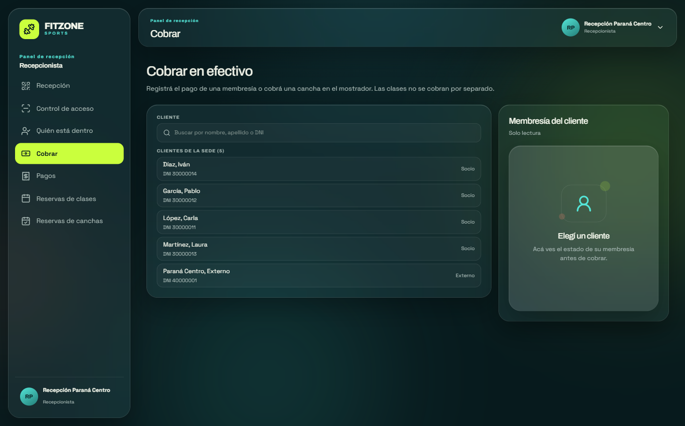
*Figura 11. Cobro en efectivo en el mostrador.*

**Aforo.** El círculo de la derecha muestra cuántas personas hay dentro y el porcentaje sobre el aforo máximo. **Quién está dentro** lista a las personas con su hora de ingreso. Para registrar una salida, tocá **Egreso** en la fila de la persona.

### 4.2 Gestión de la agenda de clases

En **Reservas de clases** ves las clases de tu sede día por día, con el cupo ocupado. Con **Anotar socio** podés reservarle una clase a un socio que está en el mostrador (hasta 30 minutos antes del inicio).

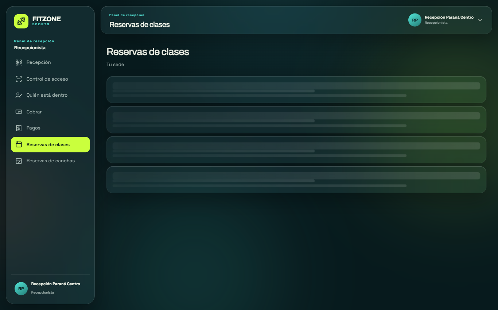
*Figura 12. Reservas de clases de la sede, por día.*

La creación y modificación de clases (horarios, instructor, cupo) la hace el gerente de sede (ver 5.4).

### 4.3 Inhabilitación de una cancha por mantenimiento

La puesta en mantenimiento la hace el **gerente de sede** desde **Canchas**:

- **Mantenimiento**: la cancha deja de aceptar reservas nuevas. Las reservas ya tomadas se mantienen.
- **Bloqueo por franja**: se bloquea un rango de fechas y horas (por ejemplo, una mañana por arreglos), sin sacar la cancha de servicio.

El recepcionista ve esas canchas y turnos como no disponibles.

### 4.4 Problemas frecuentes del mostrador

| Problema | Solución |
|---|---|
| La cámara no lee el QR | Usá el modo **Código** con los 6 dígitos |
| *Ya tiene un ingreso abierto* | El socio no marcó la salida en otra visita. Registrá el egreso en **Quién está dentro** (si es de tu sede) o pedile que lo resuelva la otra sede |
| Al socio se le venció la membresía | Cobrale la renovación en **Cobrar** (ver 4.1) y validá de nuevo |
| *Modo sin conexión* | Seguí validando con **Cámara** o **Pegado**: los ingresos quedan en cola y se envían solos al volver internet (ver 4.1). Si el aviso dice que no hay datos vigentes, anotá los ingresos en una planilla y cargalos por **DNI** al reconectar |
| Un ingreso sin conexión aparece como **Conflicto**, *El socio ya tenía un ingreso abierto* | El ingreso offline **no se registró**: el sistema ya tenía a esa persona dentro. Revisá **Quién está dentro**, registrá el egreso anterior si corresponde y, si la persona sigue en la sede, cargá su ingreso por **DNI** |
| Un ingreso sin conexión aparece como **Observado** | Se registró igual, porque la persona ya había entrado, pero la membresía no estaba vigente o la sede superaba el aforo al sincronizar. Avisá a la gerencia de sede |
| Un ingreso sin conexión aparece como **Rechazado** | El sistema no aceptó el QR (no válido, vencido o con más de 72 horas). Si la persona entró, cargá su ingreso por **DNI** |
| No veo ninguna sede | Tu usuario no tiene sede asignada: pedile al gerente que te la asigne |

---

## 5. Manual del Gerente central

El gerente general ingresa por `/admin/login` y ve toda la cadena. El gerente de sede ve las mismas pantallas, limitadas a su sede y sin edición de precios.

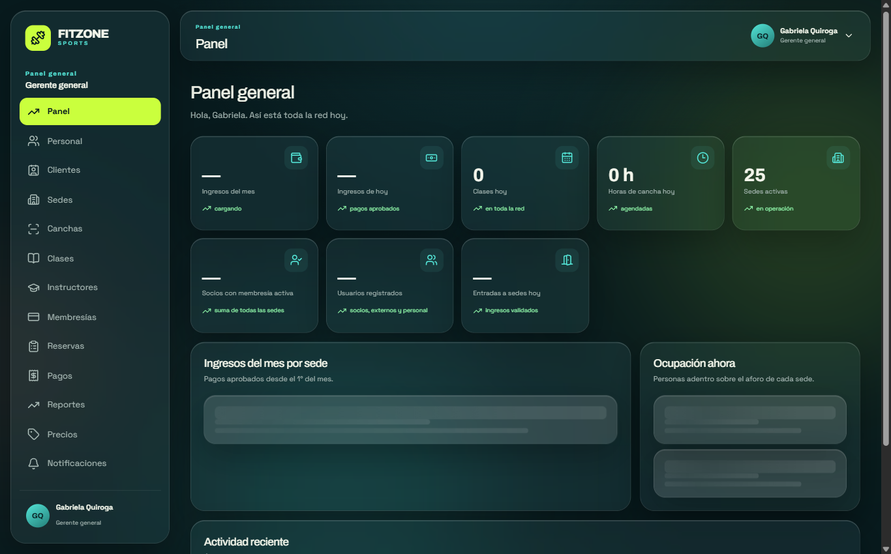
*Figura 13. Panel general: indicadores de toda la red.*

### 5.1 Alta y configuración de una sede

1. Entrá a **Sedes** → **Nueva sede**.
2. Cargá nombre, dirección y **aforo máximo**.
3. Definí las **franjas horarias** de apertura (por ejemplo, de 07:00 a 23:00).
4. En **Canchas**, agregá las canchas de la sede con su tipo y precio por hora.
5. En **Clases**, creá las clases: tipo, instructor, cupo y horas semanales. El sistema sugiere días y horarios según los huecos libres; podés editarlos antes de confirmar. Las fechas concretas (ocurrencias) se generan solas para las próximas 4 semanas.
6. En **Personal**, creá el gerente de sede y los recepcionistas.

La sede queda operativa en el momento: **no hace falta reiniciar el sistema**.

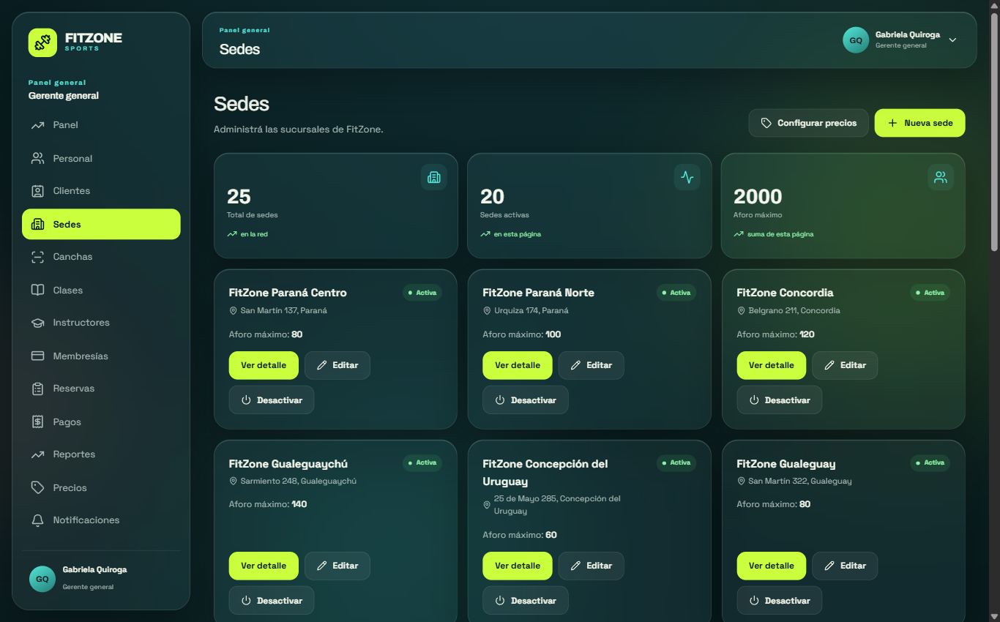
*Figura 14. Listado de sedes de la cadena.*

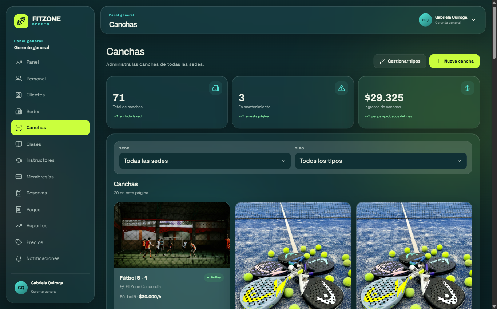
*Figura 15. Canchas por sede, con precio por hora y estado.*

### 5.2 Definición de precios, descuentos y horario pico

En **Precios** el gerente general edita el precio de cada plan de membresía (mensual, trimestral, anual). El cambio rige para los pagos siguientes.

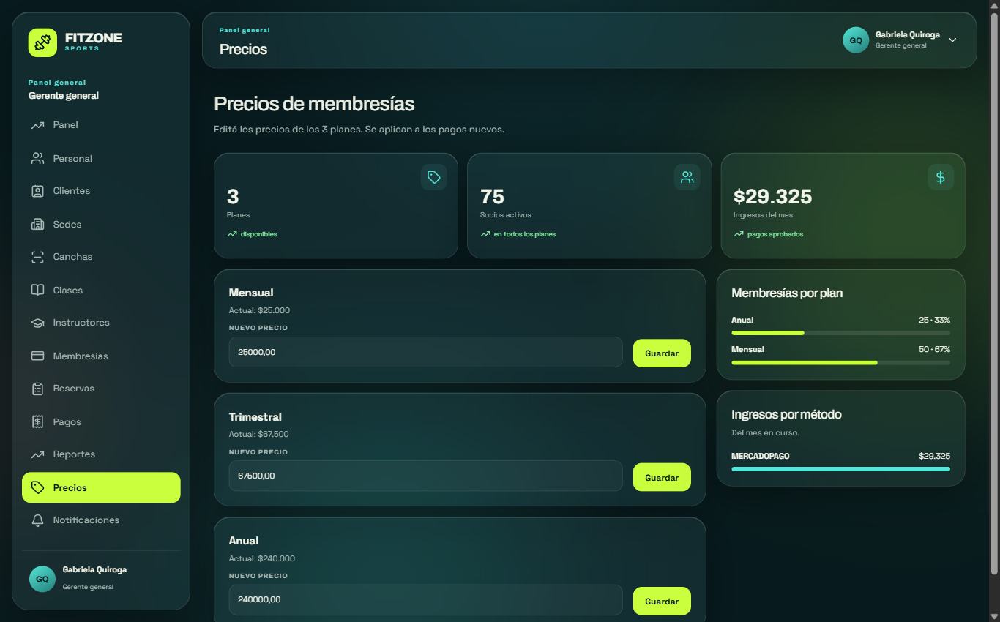
*Figura 16. Precios de los planes de membresía.*

El **precio por hora de cada cancha** se edita en **Canchas**. El **descuento de socio (15 %)** y el **recargo de hora pico (15 %, de 19 a 21 h)** son reglas del sistema y se aplican solos.

### 5.3 Lectura de los reportes consolidados

**Reportes** tiene, arriba, indicadores de la red (o de tu sede, si sos gerente de sede): acciones auditadas hoy, ingresos de hoy, ingresos del mes con la comparación contra el mes anterior y, para el gerente general, la sede con más ingresos. Debajo hay dos pestañas:

- **Auditoría:** el registro de las acciones sensibles del sistema. Se filtra por entidad (sede, usuario, cancha, clase, pago, membresía, precio de plan o instructor) y por rango de fechas, y cada fila muestra la acción, la entidad, quién la hizo y cuándo.
- **Por sede** (para el gerente de sede, **Mi sede**): el gerente general elige una sede y ve sus ingresos del mes, los socios con membresía, las canchas y las clases, el estado de las membresías (activas) y un acceso directo a **Métricas de accesos**.

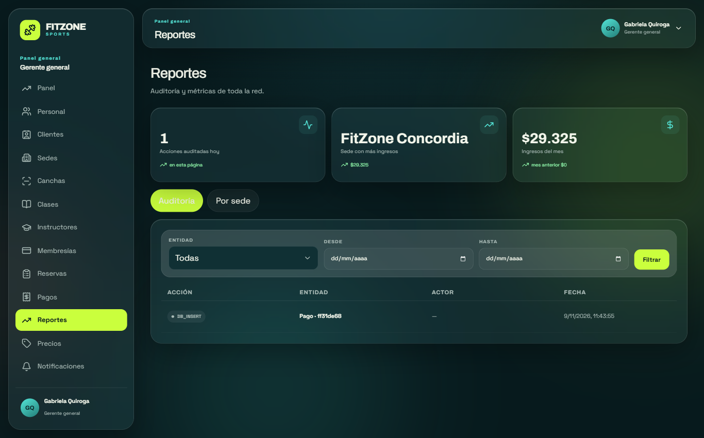
*Figura 17. Reportes: indicadores y pestaña de auditoría.*

Otras lecturas que no están en Reportes:

- **Popularidad de los planes** (qué planes eligen los socios activos): en **Precios**, en el cuadro *Membresías por plan* (gerente general), y en el **Panel de sede**, en *Planes más elegidos* (gerente de sede).
- **Accesos:** **Métricas de accesos** muestra los ingresos y egresos del día y el aforo actual por sede. Se llega desde la pestaña *Por sede* de Reportes. El *Panel general* también muestra la ocupación actual de cada sede.
- **Ingresos por sede y por método de pago:** en el *Panel general* y en el *Panel de sede*.

### 5.4 Otras tareas de gestión

| Tarea | Dónde | Quién |
|---|---|---|
| Crear o dar de baja gerentes de sede | Personal | Gerente general |
| Alta y baja de recepcionistas | Personal | Gerente general y de sede |
| Instructores | Instructores | Ambos (activar o desactivar: gerente general) |
| Catálogo de tipos de cancha (por ejemplo, agregar *Tenis*) | Canchas → Tipos | Gerente general |
| Enviar avisos a socios | Notificaciones | Gerente general |
| Ver la auditoría de operaciones | Panel → Actividad reciente | Gerentes |

---

## 6. Preguntas frecuentes

**¿Puedo usar mi membresía en otra sede?** Sí. La membresía vale en todas las sedes, sin trámites.

**¿Por qué mi QR cambia todo el tiempo?** Para que nadie pueda entrar con una foto de tu QR. Cada código dura 60 segundos y sirve una vez.

**Pagué y no veo la membresía activa.** Si el pago se rechazó, la membresía no se activa. Revisá *Mis pagos* y volvé a intentar.

**Renové antes de que venza, ¿pierdo días?** No. El nuevo período empieza el día en que termina el actual.

**¿Por qué pagué más caro una cancha?** Los turnos que empiezan entre las 19:00 y las 20:59 tienen un recargo del 15 %. Si tu cuota está vencida, además no se aplica el descuento de socio.

**Me anoté en lista de espera, ¿tengo que estar atento?** No. Si se libera un lugar, el sistema te pasa a la clase automáticamente y te avisa.

**¿Puedo cancelar una clase a último momento?** Hasta 2 horas antes del inicio. Después, el portal ya no lo permite.

**¿Qué pasa si la sede se queda sin internet?** El recepcionista puede seguir validando tu QR con los datos que su pantalla descargó antes de la caída. Tu ingreso queda guardado y se envía cuando vuelve la conexión. Sin internet en la sede no se puede usar el código de 6 dígitos ni el ingreso por DNI. Si es tu teléfono el que no tiene datos, el QR no se puede mostrar (ver 3.4).

**No me llegó el mail de verificación.** Revisá la carpeta de spam. Desde la pantalla de ingreso se puede pedir el reenvío.

**¿Cómo recibo notificaciones en el teléfono?** Instalá la aplicación (3.3) y tocá *Activar* en el aviso de notificaciones del inicio.
